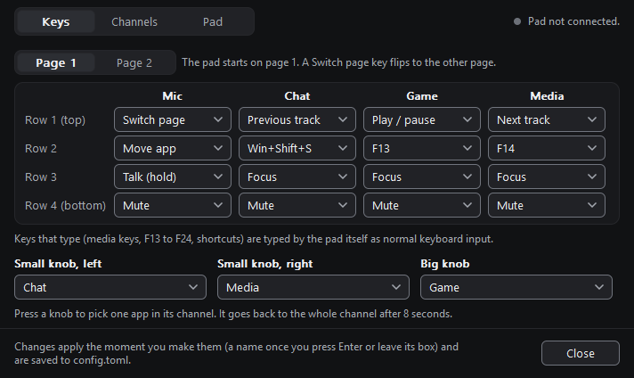
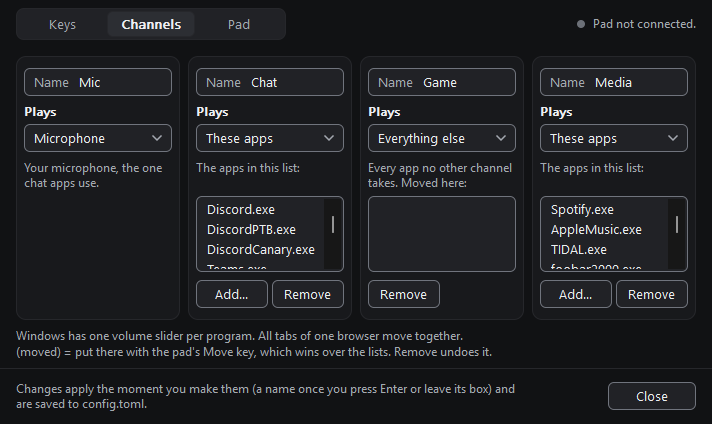
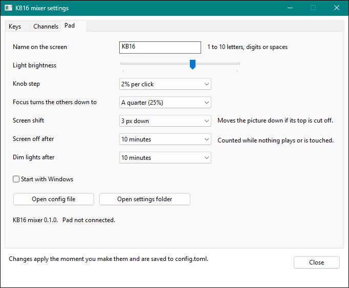
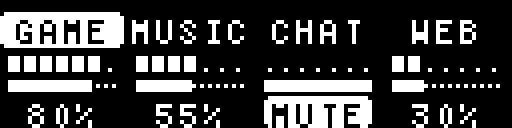
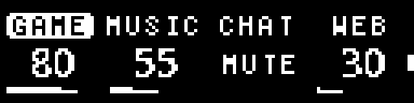
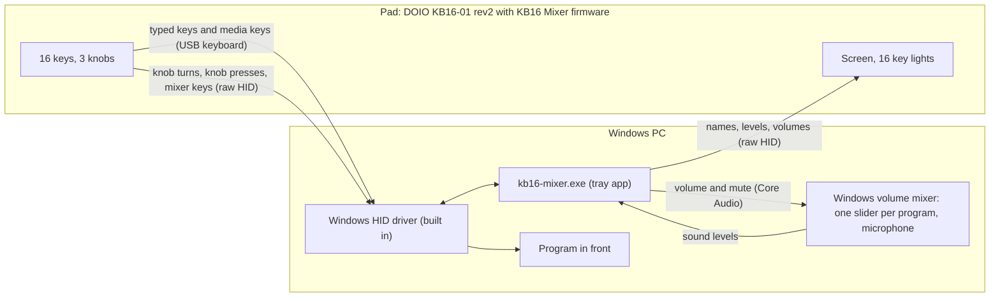

# KB16 Mixer

KB16 Mixer is firmware and a small Windows tray app. They make the **DOIO KB16-01 rev2** macro pad a per-app volume mixer that is also a usual keypad.

**Where to start:** you own the pad and want to use it, read [docs/install.md](docs/install.md). You want to change the code, read [CONTRIBUTING.md](CONTRIBUTING.md).

It is not a driver, and it does not route audio. The app uses no keyboard hooks and injects no input. It moves only the sliders of the Windows volume mixer.

**Status: pre-release.** The first release will be 0.1.0. At this time, it has not published it. The author did tests on one pad with Windows 11. Not tested: Windows 10, other units, the Windows flasher on the pad, a return to the stock firmware. See [Status](#status).

> **Unofficial project.** It has no connection with DOIO, and DOIO does not endorse it. You flash firmware at your own risk. A flash can void the warranty of the pad.

| Keys tab | Channels tab | Pad tab |
|---|---|---|
|  |  |  |

## What it does

- A knob turn changes the volume of a **channel**: a named list of programs, for example "Chat" or "Media".
- A knob tap mutes or unmutes what the knob turns. A knob hold selects one program in the channel. The next turns change only that program.
- A key mutes a channel. A key turns the other channels down (Focus). While you hold a key, the microphone mute changes (the **Talk** key).
- The key lights show the live sound level of each channel. The screen shows names, levels and volumes.
- The app follows the Windows default output device when it changes. You can also select one output device.
- Other keys type F13–F24, media keys or key combinations, as a usual USB keyboard.
- A second page of keys is a number pad. A key can also open a program, a file, a folder or a web address.
- Without the app, the pad is a usual keyboard. The knobs send media keys and page keys.

## What the pad shows

The screen has 128 x 32 pixels. The firmware code drew these pictures (`pad-core/examples/render_oled.rs`), at four times the size.
The pictures show the screens at rest. They do not show the motion between the screens.

| Screen | When the pad shows it |
|---|---|
|  | The logo with the name (default `KB16`). For 1.8 seconds after start, in keyboard mode, and after 45 seconds without activity. |
|  | The mixer screen, while the app runs. Each column shows a channel: the name, the live meter, the volume bar and the value. An inverted name is the channel that has Focus. `MUTE` shows a muted channel. |
|  | A readout for 1.3 seconds after a knob turn, a knob press or a mute: the name, the value and a bar |
|  | A notice for 1.3 seconds, for example `Config loaded` |
|  | The mixer screen while page 2 is active. A short mark is at the right edge. |

## Is my pad supported?

Do these checks before you change anything. If one check does not agree, **stop and do not flash**.

1. The model is **KB16-01** (16 keys, 2 small knobs, 1 large knob, a screen, a cable, no battery). The wireless KB16B-02 is not supported.
2. Device Manager shows the USB ID `VID_D010&PID_1601`.
3. In the bootloader, Windows shows `Maple 003` with the USB ID `1EAF:0003`. A rev1 pad shows a different bootloader.
4. After you download the release zip (step 1 of the quick start), run `kb16-mixer.exe --check`. On the `pad` line, it shows `WARN  A pad with other firmware is connected (USB D010:1601, ...)`.

The full check, with the steps, is in [docs/install.md](docs/install.md#2-examine-your-pad).

## Quick start

At this time, the project has not published the first release. Until then, [build the files from source](docs/build-from-source.md).

1. Download the release zip. Compare its SHA-256 value with `SHA256SUMS`. See [Get the files](docs/install.md#1-get-the-files).
2. Do the checks of your pad. See [Examine your pad](docs/install.md#2-examine-your-pad).
3. Install the WinUSB driver for the bootloader, one time. See [Install the bootloader driver](docs/install.md#4-install-the-bootloader-driver-one-time-only).
4. Make a backup of the stock firmware. See [Make a backup](docs/install.md#5-make-a-backup-of-the-stock-firmware).
5. Flash the firmware with `flash.ps1`. Then disconnect the pad, and connect it again. See [Flash the firmware](docs/install.md#6-flash-the-firmware).
6. Start `kb16-mixer.exe`. Then run `kb16-mixer.exe --check`. See [Start the app](docs/install.md#8-start-the-app).

On the first start, the settings window opens on the **Pad** tab. The app does not start with Windows until you set **Start with Windows** to on.

**Go back:** [Back to the stock firmware](docs/stock-firmware.md) · **Problems:** [Symptoms and causes](docs/troubleshooting.md) · **Questions:** [FAQ](docs/faq.md)

## How to use the pad

This is page 1 (the mixer page) with the default settings. Each key column belongs to the channel above it.

```text
             Mic      Chat     Game     Media
          +--------+--------+--------+--------+
  row 1   | Switch |  Prev  | Play/  |  Next  |     knob 1      knob 2
          |  page  |        | Pause  |        |     (small)     (small)
          +--------+--------+--------+--------+      Chat        Media
  row 2   |  Move  |  Win+  |  F13   |  F14   |
          |        | Shift+S|        |        |     +------------------+
          +--------+--------+--------+--------+     |      screen      |
  row 3   |  Talk  | Focus  | Focus  | Focus  |     +------------------+
          |        |        |        |        |
          +--------+--------+--------+--------+           knob 3
  row 4   |  Mute  |  Mute  |  Mute  |  Mute  |           (big)
          |        |        |        |        |           Game
          +--------+--------+--------+--------+
```

This is page 2 (the keypad page) with the default settings:

```text
          +--------+--------+--------+--------+
  row 1   | Switch |   7    |   8    |   9    |
          |  page  |        |        |        |
          +--------+--------+--------+--------+
  row 2   |   0    |   4    |   5    |   6    |
          +--------+--------+--------+--------+
  row 3   | Enter  |   1    |   2    |   3    |
          +--------+--------+--------+--------+
  row 4   |  Mute  |  Mute  |  Mute  |  Mute  |
          +--------+--------+--------+--------+
```

| Control | Action |
|---|---|
| Knob, turn | Changes the volume of the knob target. One detent is 2 % (setting `step`). |
| Knob, tap | Mutes or unmutes the knob target. |
| Knob, hold (350 ms) | Selects the next knob target: the full channel, then each program that plays in the channel, then the full channel again. After 8 seconds without a touch, the knob goes back to the full channel. |
| Mute | Mutes or unmutes the channel of its column. A muted column shows amber lights. |
| Focus, tap | Turns all other channels down (to 25 % of their level, setting `duck`). Tap again to stop. |
| Focus, hold | The same as a tap, but Focus stops when you release the key. |
| Talk, hold | Changes the microphone mute while you hold the key. |
| Switch page, tap | Changes to the other page. The screen shows `MIXER` or `KEYS`. |
| Switch page, hold | Shows the other page only while you hold the key. |
| Move, hold + a mixer key of a column | Moves the foreground program into the channel of that column. Do it again to cancel the move. |
| Move, tap | Shows the channel of the foreground program on the screen. |
| F13–F24, media keys, shortcuts, digits | The pad types these keys itself. |

You can change the knob tap, hold and double tap in `[knob_press]`. A Mute key or an `open:` key can also have a hold and a double tap. See [Knob presses](docs/configuration.md#knob-presses).

For a knob hold, the pad must have firmware that is newer than the draft release 0.1.0. With the firmware of the draft release, each knob press is a tap.

When the app does not run, the keys type `1`–`0`, arrows, Enter and Backspace. Knob 1 sends Next, Previous and Play/Pause. Knob 2 sends Page Up, Page Down and Home. Knob 3 sends Volume up, Volume down and Mute. See [Keyboard mode](docs/configuration.md#keyboard-mode).

Click the tray icon to open the settings window. A change applies immediately. The app keeps the settings in `%APPDATA%\kb16-mixer\config.toml`. See [docs/configuration.md](docs/configuration.md).

## How it fits together



The pad is a standard USB HID device. Windows uses its own driver. The app communicates with the pad through one vendor-defined HID interface, and to the volume mixer through the Windows Core Audio API.
For the details, see [docs/how-it-works.md](docs/how-it-works.md).

## Status

The project did its tests on one pad (KB16-01 rev2, Windows 11). This table shows the tests, and how the project did them:

| Item | On the pad | Automated tests |
|---|---|---|
| Knob volume for each channel, the Mute row, key lights and screen (an earlier build, before 0.1.0) | VERIFIED |  |
| Recovery with the top-left key at plug-in (an earlier build, before 0.1.0) | VERIFIED |  |
| Two key pages | NOT YET VERIFIED | yes |
| Knob hold to select one program in a channel | NOT YET VERIFIED | yes |
| Knob tap to mute, knob double tap, and hold and double tap on keys | NOT YET VERIFIED | yes |
| The app follows the Windows default output device, or uses a chosen device | NOT YET VERIFIED | yes (the logic only) |
| Light and screen motion, the idle dim and off of the lights, and the new channel tints | NOT YET VERIFIED | yes (the logic only) |
| Volume balance (trim) rules, and Focus with several audio sessions of one program | NOT YET VERIFIED | yes |
| The feel of Focus, Talk and Move | NOT YET VERIFIED | yes (the logic only) |
| Idle rule (screen off and lights dim only after no sound and no touch) | NOT YET VERIFIED | yes |
| Name on the logo screen, kept in the pad | NOT YET VERIFIED | yes |
| `open:` key action | NOT YET VERIFIED | yes |
| Settings window: live clicks, and display scale 125 % and 150 % | NOT YET VERIFIED | yes (the logic only) |
| `scripts/flash.ps1` and `scripts/flash.sh` from start to end | NOT YET VERIFIED | yes, with stub programs in place of `dfu-util` and the pad |
| Bootloader entry from the DOIO factory firmware, and a return to a backup of it (the author's pad had a community firmware, not the factory firmware) | NOT YET VERIFIED |  |
| The pad stays in the bootloader after three crashed starts in a row | NOT YET VERIFIED | yes (the counter rule) |
| No flicker of the key lights, and the physical order of the knobs | NOT YET VERIFIED |  |
| Windows 10 | NOT YET VERIFIED |  |

The full record, with the dates and the firmware versions, is in [docs/testing.md](docs/testing.md#verified-on-the-pad).
The table shows the state on the date of the last change. Report your results, good or bad, in an issue.

**Protection of the pad.** The firmware writes the flash only in two reserved pages. It does not write the bootloader region. Three procedures put the pad into the bootloader while this firmware runs. Before they write, the two flashers examine the image. `flash.ps1` also examines the device and asks you to type `YES`. See [Recovery](docs/flashing.md#recovery).

## Repository map

| Folder | Contents |
|---|---|
| `protocol/` | The raw HID wire format, shared by the firmware and the app |
| `pad-core/` | The firmware logic that needs no hardware, with tests that run on the PC |
| `firmware/` | The firmware for the pad (Rust, Embassy) |
| `app/` | The Windows tray app (Rust) |
| `scripts/` | Build scripts, the two flashers (`flash.ps1`, `flash.sh`), the licence-notice script |
| `docs/` | The documentation |
| `.github/` | CI, the release workflow, and the templates for issues and pull requests |

## Documentation

| Document | Contents |
|---|---|
| [docs/install.md](docs/install.md) | Install on Windows, step by step, from the release zip |
| [docs/stock-firmware.md](docs/stock-firmware.md) | Bootloader entry from the stock firmware, backup, restore |
| [docs/troubleshooting.md](docs/troubleshooting.md) | Symptoms, causes and repairs |
| [docs/faq.md](docs/faq.md) | Driver, anti-cheat, rights, stored data, network, uninstall |
| [docs/configuration.md](docs/configuration.md) | The settings window and all settings of `config.toml` |
| [docs/design/settings-ui.md](docs/design/settings-ui.md) | The design of the settings window: colours, controls, motion and drawing |
| [docs/how-it-works.md](docs/how-it-works.md) | Architecture, the volume rules, and what the app touches in Windows |
| [docs/protocol.md](docs/protocol.md) | The raw HID messages between the pad and the app |
| [docs/flashing.md](docs/flashing.md) | Flashing for developers: `flash.sh`, `dfu-util`, recovery |
| [docs/build-from-source.md](docs/build-from-source.md) | The Windows toolchain and the build scripts |
| [docs/hardware.md](docs/hardware.md) | Chip, pins, memory map and bootloader, for firmware writers |
| [docs/testing.md](docs/testing.md) | How the project is tested |
| [docs/glossary.md](docs/glossary.md) | The terms of this project |
| [docs/roadmap.md](docs/roadmap.md) | Planned work |

## Contributing

See [CONTRIBUTING.md](CONTRIBUTING.md). All contributors follow the [Code of Conduct](CODE_OF_CONDUCT.md).
To report a security problem, see [SECURITY.md](SECURITY.md). For the list of changes, see [CHANGELOG.md](CHANGELOG.md).

## Licence and legal notes

- The code has the MIT licence. See [LICENSE](LICENSE).
- The screen fonts are Open Sans (SIL Open Font License 1.1) and the X11 5x7 font, which is in the public domain. The build turns them into bitmaps.
- All dependencies have permissive licences. [THIRD_PARTY_NOTICES.md](THIRD_PARTY_NOTICES.md) gives their copyright notices and full licence texts.
- All firmware code, also the knob decoder, is original to this project. The pin assignments come from the public QMK board definition, as facts.
- This project does not include `dfu-util`, a driver, a driver installer or a stock firmware.
- This is an unofficial project. It has no connection with DOIO, and DOIO does not endorse it.
- All product names and company names are trademarks of their owners. This project uses them only to tell which devices are compatible.
- You flash firmware at your own risk. A flash can void the warranty of the pad.
- The software comes with no warranty. See the MIT licence.
