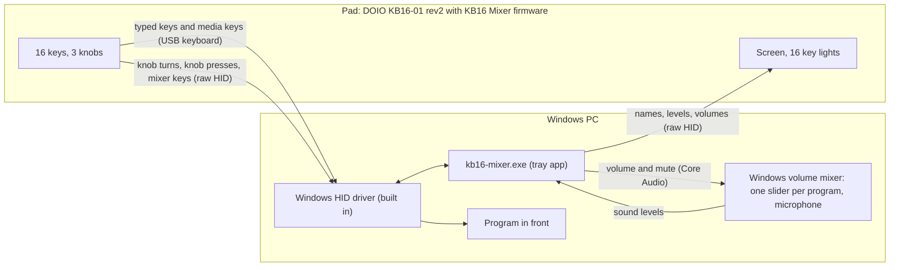

# KB16 Mixer

KB16 Mixer is firmware and a small Windows tray app. They make the **DOIO KB16-01 rev2** macro pad a per-app volume mixer that is also a normal keypad.

It is not a driver, and it does not route audio. The app uses no keyboard hooks and injects no input. It moves only the sliders of the Windows volume mixer.

**Status: pre-release.** The project plans a first release (0.1.0). It has not published it yet. Tested on one pad with Windows 11. Not tested: Windows 10, other units, the Windows flasher on the pad, a restore of the stock firmware. See [Status](#status).

> **Unofficial project.** It has no connection with DOIO, and DOIO does not endorse it. You flash firmware at your own risk. A flash can void the warranty of the pad.

| Keys tab | Channels tab | Pad tab |
|---|---|---|
|  |  |  |

## How it fits together



The pad is a standard USB HID device. Windows uses its own driver. The app talks to the pad through one vendor-defined HID interface, and to the volume mixer through the Windows Core Audio API.
For the details, see [docs/how-it-works.md](docs/how-it-works.md).

## What it does

- A knob turn changes the volume of a **channel**: a named list of programs, for example "Chat" or "Media".
- A knob press selects one program in the channel. The next turns change only that program.
- A key mutes a channel. A key turns the other channels down (Focus). A held key unmutes your microphone (Talk).
- The key lights show the live sound level of each channel. The screen shows names, levels and volumes.
- Other keys type F13–F24, media keys or key combinations, as a normal USB keyboard.
- A second page of keys is a number pad. A key can also open a program, a file, a folder or a web address.
- Without the app, the pad is a normal keyboard with media knobs.

## Is my pad supported?

Do these checks before you change anything. If one check does not agree, **stop and do not flash**.

1. The model is **KB16-01** (16 keys, 2 small knobs, 1 big knob, a screen, a cable, no battery). The wireless KB16B-02 is not supported.
2. Device Manager shows the USB ID `VID_D010&PID_1601`.
3. `kb16-mixer.exe --check` shows `pad  WARN  A pad with other firmware is connected (USB D010:1601, ...)`.
4. In the bootloader, Windows shows `Maple 003` with the USB ID `1EAF:0003`. A rev1 pad shows a different bootloader.

The full check, with the steps, is in [docs/install.md](docs/install.md#2-check-your-pad).

## Quick start

The project has not published the first release yet. Until then, [build the files from source](docs/build-from-source.md).

1. Download the release zip. Check its SHA-256 value. See [Get the files](docs/install.md#1-get-the-files).
2. Check your pad. See [Check your pad](docs/install.md#2-check-your-pad).
3. Install the WinUSB driver for the bootloader, one time. See [Install the bootloader driver](docs/install.md#4-install-the-bootloader-driver-one-time-only).
4. Make a backup of the stock firmware. See [Make a backup](docs/install.md#5-make-a-backup-of-the-stock-firmware).
5. Flash the firmware with `flash.ps1`. Then disconnect the pad, and connect it again. See [Flash the firmware](docs/install.md#6-flash-the-firmware).
6. Start `kb16-mixer.exe`. Then run `kb16-mixer.exe --check`. See [Start the app](docs/install.md#8-start-the-app).

On the first start, the settings window opens on the **Pad** tab. The app does not start with Windows until you select **Start with Windows**.

**Go back:** [Back to the stock firmware](docs/stock-firmware.md) · **Problems:** [Troubleshooting](docs/troubleshooting.md) · **Questions:** [FAQ](docs/faq.md)

## How to use the pad

This is page 1 (the mixer page) with the default settings. Each key column belongs to the channel above it.

```text
             Mic      Chat     Game     Media
          +--------+--------+--------+--------+
  row 1   | Switch |  Prev  | Play/  |  Next  |     knob 1      knob 2
          |  page  |        | Pause  |        |     (small)     (small)
          +--------+--------+--------+--------+      Chat        Media
  row 2   |  Move  |  Win+  |  F13   |  F14   |
          |        | Shift+S|        |        |     +------------------+
          +--------+--------+--------+--------+     |      screen      |
  row 3   |  Talk  | Focus  | Focus  | Focus  |     +------------------+
          |        |        |        |        |
          +--------+--------+--------+--------+           knob 3
  row 4   |  Mute  |  Mute  |  Mute  |  Mute  |           (big)
          |        |        |        |        |           Game
          +--------+--------+--------+--------+
```

This is page 2 (the keypad page) with the default settings:

```text
          +--------+--------+--------+--------+
  row 1   | Switch |   7    |   8    |   9    |
          |  page  |        |        |        |
          +--------+--------+--------+--------+
  row 2   |   0    |   4    |   5    |   6    |
          +--------+--------+--------+--------+
  row 3   | Enter  |   1    |   2    |   3    |
          +--------+--------+--------+--------+
  row 4   |  Mute  |  Mute  |  Mute  |  Mute  |
          +--------+--------+--------+--------+
```

| Control | Action |
|---|---|
| Knob, turn | Changes the volume of the knob target. One detent is 2 % (setting `step`). |
| Knob, press | Selects the next knob target: the whole channel, then each program that plays in the channel, then the whole channel again. After 8 seconds without a touch, the knob goes back to the whole channel. |
| Mute | Mutes or unmutes the channel of its column. A muted column shows amber lights. |
| Focus, tap | Turns all other channels down (to 25 %, setting `duck`). Tap again to stop. |
| Focus, hold | The same as a tap, but Focus stops when you release the key. |
| Talk, hold | Changes the microphone mute while you hold the key. |
| Switch page, tap | Changes to the other page. The screen shows `MIXER` or `KEYS`. |
| Switch page, hold | Shows the other page only while you hold the key. |
| Move, hold + a mixer key of a column | Moves the foreground program into the channel of that column. Do it again to undo. |
| Move, tap | Shows the channel of the foreground program on the screen. |
| F13–F24, media keys, shortcuts, digits | The pad types these keys itself. |

A knob press does not mute. Use the Mute keys.
When the app does not run, the keys type `1`–`0`, arrows, Enter and Backspace, and the knobs send media keys. See [Keyboard mode](docs/configuration.md#keyboard-mode).

Click the tray icon to open the settings window. A change applies immediately. The app keeps the settings in `%APPDATA%\kb16-mixer\config.toml`. See [docs/configuration.md](docs/configuration.md).

## Status

The project has one tested pad (KB16-01 rev2, Windows 11). This table shows what the project tested, and how:

| Item | Tested on the real pad | Tested by automated tests and builds only | Not tested |
|---|---|---|---|
| Basic mixer: a knob moves a channel, Mute keys, meters (earlier version) | yes | | |
| Focus, Talk, Move (earlier version) | yes | | |
| Keys, knob turns, key lights, screen | yes | | |
| Flashing with `dfu-util` and `scripts/flash.sh`, and recovery with the keys | yes, with earlier versions of the firmware | | |
| Bootloader entry with the top-left key, from a community firmware | yes | | |
| WinUSB driver with the QMK driver installer | yes | | |
| Two key pages | | yes | |
| Knob press to select one program in a channel | | yes | |
| Volume balance (trim) rules | | yes | |
| Focus with several audio sessions of one program | | yes | |
| Idle rule (screen off and lights dim only after no sound and no touch) | | yes | |
| Name on the logo screen, kept in the pad | | yes | |
| `open:` key action | | yes | |
| Settings window with three tabs | | yes | |
| `scripts/flash.ps1` (its checks, with a simulated `dfu-util`) | | yes | |
| `scripts/flash.ps1` end to end on the pad | | | yes |
| Bootloader entry from the DOIO factory firmware | | | yes |
| Backup and restore of a factory firmware | | | yes |
| The pad stays in the bootloader after three crashed starts in a row | | | yes |
| A firmware image that does not start at all (for example, after an interrupted download) | | | yes |
| Windows 10 | | | yes |

The table shows the state on the date of the last change. Report your results, good or bad, in an issue.

Safeguards: the firmware never writes the bootloader region. Three ways lead into the bootloader while this firmware runs. Both flashers check the device and the image before they write. See [Recovery](docs/flashing.md#recovery).

## Repository map

| Folder | Contents |
|---|---|
| `protocol/` | The raw HID wire format, shared by the firmware and the app |
| `pad-core/` | The firmware logic that needs no hardware, with tests that run on the PC |
| `firmware/` | The firmware for the pad (Rust, Embassy) |
| `app/` | The Windows tray app (Rust) |
| `scripts/` | Build scripts, the two flashers (`flash.ps1`, `flash.sh`), the licence-notice script |
| `docs/` | The documentation |
| `.github/` | CI, the release workflow, and the templates for issues and pull requests |

## Documentation

| Document | Contents |
|---|---|
| [docs/install.md](docs/install.md) | Install on Windows, step by step, from the release zip |
| [docs/stock-firmware.md](docs/stock-firmware.md) | Bootloader entry from the stock firmware, backup, restore |
| [docs/troubleshooting.md](docs/troubleshooting.md) | Symptoms, causes and fixes |
| [docs/faq.md](docs/faq.md) | Driver, anti-cheat, rights, stored data, network, uninstall |
| [docs/configuration.md](docs/configuration.md) | The settings window and all settings of `config.toml` |
| [docs/how-it-works.md](docs/how-it-works.md) | Architecture, the volume rules, and what the app touches in Windows |
| [docs/protocol.md](docs/protocol.md) | The raw HID messages between the pad and the app |
| [docs/flashing.md](docs/flashing.md) | Flashing for developers: `flash.sh`, `dfu-util`, recovery |
| [docs/build-from-source.md](docs/build-from-source.md) | The Windows toolchain and the build scripts |
| [docs/hardware.md](docs/hardware.md) | Chip, pins, memory map and bootloader, for firmware writers |
| [docs/testing.md](docs/testing.md) | How the project is tested |
| [docs/glossary.md](docs/glossary.md) | The terms of this project |
| [docs/roadmap.md](docs/roadmap.md) | Planned work |

## Contributing

See [CONTRIBUTING.md](CONTRIBUTING.md). All contributors follow the [Code of Conduct](CODE_OF_CONDUCT.md).
To report a security problem, see [SECURITY.md](SECURITY.md). For the list of changes, see [CHANGELOG.md](CHANGELOG.md).

## Licence and legal notes

- The code has the MIT licence. See [LICENSE](LICENSE).
- The screen fonts are Open Sans (SIL Open Font License 1.1) and the X11 5x7 font, which is in the public domain. The build turns them into bitmaps.
- All dependencies have permissive licences. [THIRD_PARTY_NOTICES.md](THIRD_PARTY_NOTICES.md) gives their copyright notices and full licence texts.
- All firmware code, also the knob decoder, is original to this project. The pin assignments come from the public QMK board definition, as facts.
- This project does not include `dfu-util`, a driver, a driver installer or any stock firmware.
- This is an unofficial project. It has no connection with DOIO, and DOIO does not endorse it.
- All product names and company names are trademarks of their owners. This project uses them only to describe compatibility.
- You flash firmware at your own risk. A flash can void the warranty of the pad.
- The software comes with no warranty. See the MIT licence.
