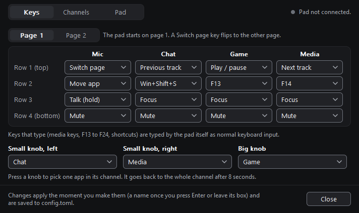
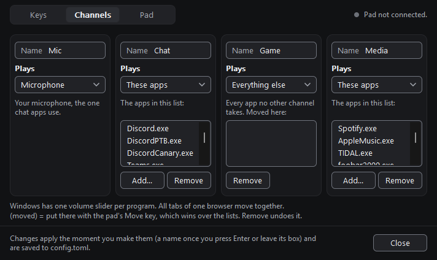
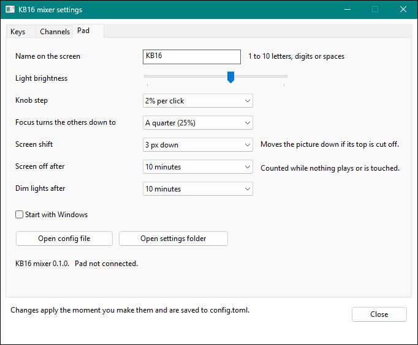

# Configuration

Read this document after the install, when you want to change the keys, the channels or the knobs.
This document gives the settings window and the config file of the app, `config.toml`.
The source of the default file is `DEFAULT` in `app/src/config.rs`.
For the definition of each term, see [glossary.md](glossary.md).

## Contents

- [Where the files are](#where-the-files-are)
- [The first start](#the-first-start)
- [The settings window](#the-settings-window)
- [Edit the file by hand](#edit-the-file-by-hand)
- [General settings](#general-settings)
- [Key lights](#key-lights)
- [Screen style](#screen-style)
- [Audio output](#audio-output)
- [Knobs](#knobs)
- [Keys and pages](#keys-and-pages)
- [Channels](#channels)
- [Examples](#examples)
- [Error messages](#error-messages)
- [Keyboard mode](#keyboard-mode)
- [Command-line options and environment variables](#command-line-options-and-environment-variables)

## Where the files are

All files are in the settings folder, `%APPDATA%\kb16-mixer`.
The environment variable `KB16_MIXER_DIR` can replace this folder. See [Environment variables](#environment-variables).

| File | Contents | Who writes it |
|---|---|---|
| `config.toml` | All settings | You, or the settings window. The app writes the defaults on the first start. |
| `apps.toml` | Programs that you moved to a channel with the Move key | Only the app. To undo a move, use **Remove** in the settings window, or delete the line. |
| `state.toml` | Channel levels that you set on the pad, the trim of each program, levels to restore after Focus, and the mute state of the microphone while you hold **Talk** | The app |
| `log.txt` | Problems and errors | The app |
| `selftest.txt` | Output of `kb16-mixer.exe --selftest` | The app |

To open the folder:

1. Right-click the tray icon.
2. Click **Open settings folder**.

## The first start

On the first start (when `config.toml` does not exist), the app does these steps:

1. It writes `config.toml` with the default settings.
2. It opens the settings window on the **Pad** tab.
3. The status line tells you that the app is in the tray, near the clock (possibly behind the `^` arrow).

The app does **not** start with Windows until you set **Start with Windows** to on, on the **Pad** tab.

## The settings window

To open the window, click the tray icon. You can also use the **Settings...** item of the tray menu. To open the tray menu, right-click the tray icon.
The window has three tabs: **Keys**, **Channels** and **Pad**.

A change in a list, a slider, a switch or a button applies immediately and goes into `config.toml`.
The text boxes are the channel names and the name on the screen. A text box uses its value when you press Enter, go to a different control, or close the window.
While you type, the status line tells you if the name is not correct.
The app keeps the comments and the layout of the file.
The status line at the bottom says what changed, or why the app did not accept a change.

- The window does not accept a change that makes the file incorrect. The status line then gives the reason.
- If `config.toml` has an error, the window writes nothing until you correct the file.
- If you change the file in a text editor, the window shows the new contents when you come back to it.

In the window, "app" means a program, for example "These apps" or "App in front".

### Keys tab



| Control | Use |
|---|---|
| **Page 1**, **Page 2** | In the header, at the right of the tabs. Select the page that the key grid shows. The pad starts on page 1. |
| Column names | The name of the channel of each column, or "(no channel)" |
| **Row 1 (top)** to **Row 4 (bottom)** | One list for each key. Select the action of the key. |
| **Left knob**, **Right knob**, **Big knob** | One row for each knob. |
| **Turn** | Select the target of the knob. See [Knobs](#knobs). |
| **Tap**, **Hold**, **Double tap** | Select the action of each knob press. See [Knob presses](#knob-presses). |

The key lists contain these entries:

| Entry | Action |
|---|---|
| **Mute**, **Focus**, **Talk (hold)**, **Move app**, **Switch page** | The mixer actions. See [Mixer actions](#mixer-actions). |
| **Play / pause**, **Next track**, **Previous track**, **Next (hold: prev)**, **Stop** | Media keys |
| **F13** to **F24** | Function keys |
| **Nothing** | The key does nothing. |
| **Shortcut...** | Opens the [Shortcut dialog](#shortcut-dialog). |
| **Open...** | Opens the [Open dialog](#open-dialog). |

The knob press lists contain these entries:

| Entry | Action | Config value |
|---|---|---|
| **Mute** | Mutes or unmutes the knob target. The default for **Tap**. | `mute` |
| **Pick app** | Selects the next program in the channel. The default for **Hold**. | `pick` |
| **Nothing** | The press does nothing. The default for **Double tap**. | `none` |
| **Open** and the target, for example **Open obs64.exe** | The current target, if the press opens a target. | `open:<what>` |
| **Open...** | Opens the [Open dialog](#open-dialog). | `open:<what>` |

The window has no controls for the hold and the double tap of a key. There is no space for them.
To set them, edit `config.toml`. See [Hold and double tap on keys](#hold-and-double-tap-on-keys).

A key can have an action from the config file that is not in the list, for example `ctrl+shift+m`. The list then shows it as an extra entry.

The knob lists contain the channel names, **Master volume**, **Microphone**, **App in front** and **Focused channel**.

The window does not accept a key change that keeps a **Switch page** key on page 1 and none on page 2.
Put the **Switch page** key on page 2 first.

### Shortcut dialog

The dialog sets a key to a combination, for example Ctrl+Shift+M.

1. Click the box.
2. Press the keys. The box shows them, for example `Ctrl+Shift+M`.
3. To add the Win key, select **Add the Win key**.
4. Click **OK**.

To set the key to nothing, click **Clear**. To keep the previous setting, click **Cancel**.

- The dialog reads keys only from its own box, while that box has the keyboard focus. It uses no hook.
- Windows keeps some combinations for itself (for example Win+L and Ctrl+Alt+Del, and often the Win key). The dialog cannot see these. Type them into the config file, for example `"win+l"`.
- The dialog rejects keys that the pad cannot type, for example the number-pad keys and the Pause key. It then shows: "The pad cannot type that key. Letters, digits, F1 to F24, Enter, arrows and the like work."

### Open dialog

The dialog sets a key to `open:<target>`.

1. Type the target, or click **Browse...** to select a file.
2. Click **OK**.

The target can be a program, a folder, a file or a web address. Examples: `C:\Tools\obs64.exe`, `%USERPROFILE%\Downloads`, `https://example.com`.

### Channels tab



The tab has one column for each channel.

| Control | Use |
|---|---|
| **Name** | The name of the channel: 1 to 5 letters, digits or spaces. Press Enter or leave the box to apply it. |
| **Plays** | The kind of channel: **These apps**, **Everything else**, **Microphone** or **App in front** |
| List | The programs of the channel |
| **Add...** | Adds a program to the channel. Only for **These apps**. |
| **Remove** | Removes the selected program from the channel |

| Kind | Config value | The channel controls |
|---|---|---|
| **These apps** | `apps = [...]` | The programs in its list |
| **Everything else** | `target = "other"` | All programs that no other channel takes |
| **Microphone** | `target = "mic"` | The microphone. The tab shows no list for it. |
| **App in front** | `target = "focused"` | The foreground program. When the desktop or the taskbar is in front, no program is in front. |

The list shows each program in the channel that the app gives it. A program that you moved with the Move key shows "(moved)".
A moved program wins over the lists. **Remove** on a moved program cancels the move.
The lists of **Everything else** and **App in front** show only the moved programs.

**Add...** opens a menu:

- The programs that have a volume slider at this time, with their current channel, for example "(now in Media)".
- **Type a program name...**: a dialog for a program name, as Task Manager shows it on the **Details** tab (for example `Spotify.exe`).

A program that you add to one channel goes out of the list of all other channels.

The window does not accept these changes:

- A name that another channel has.
- A name that the knobs read as a different target: `master`, `system`, `mic`, `focused` or `selected`. The microphone channel can have the name `Mic`.
- A second channel of the type **Everything else**, **Microphone** or **App in front**. Only one channel can have each of these types.
- A channel with the name `Mic` that is not of the type **Microphone**.

To add or remove a channel, edit the config file. See [Channels](#channels).

### Pad tab



| Control | Values | Config setting |
|---|---|---|
| **Name on the screen** | 1 to 10 letters, digits or spaces. Press Enter or leave the box to apply it. | `name` |
| **Screen style** | Classic, Lean or Numbers | `[screen] style` |
| **Light brightness** | A slider, 10 % to 100 % | `brightness` |
| **Knob step** | 1, 2, 3, 5 or 10 % per click | `step` |
| **Focus turns the others down to** | Almost silent (10 %), A quarter (25 %), Half (50 %), Three quarters (75 %) | `duck` |
| **Output device** | **Windows default output**, then each active output device by name. A chosen device that is not connected shows as "*name* (not connected)". It stays chosen. | `[audio] output` |
| **Screen shift** | 0 to 6 px down | `oled_top` |
| **Screen off after** | 1, 2, 5, 10 or 30 minutes, 1 hour, or Never | `screen_off_min` |
| **Dim lights after** | 1, 2, 5, 10 or 30 minutes, 1 hour, or Never | `lights_dim_min` |
| **Dim lights to** | Default (6%), 3%, 10%, 20% or 30% | `[lights] idle_percent` (0 = Default) |
| **Start with Windows** | On or off | The registry, not the config file |
| **Open config file** | Opens `config.toml` in Notepad | |
| **Open settings folder** | Opens the settings folder in Explorer | |

The **Name on the screen**, **Screen style**, **Screen shift** and **Screen off after** controls are on the **Screen** card.
The **Knob step**, **Focus turns the others down to** and **Output device** controls are on the **Sound** card.

The window reads the list of output devices when it opens and when you open the list.
Windows does not give the name of a device that is not connected. Thus the window writes the device name as a comment after the ID, for example `output = "{...}"  # Speakers`.

A value of `idle_percent` that is not in the list shows as the nearest entry. The value 6 shows as **Default (6%)**.

The line below the buttons shows the version of the app, for example `KB16 mixer 0.2.0.`
The top right of the window shows the firmware version, for example `Pad firmware 0.2.0.`, on each tab. If no pad is connected, it shows `Pad not connected.`

## Edit the file by hand

1. Right-click the tray icon.
2. Click **Open config file**.
3. Change the file.
4. Save the file.
5. Right-click the tray icon.
6. Click **Reload config file**.

If the file has an error, the app keeps the last correct settings.
The tray menu then shows "Config problem" and the cause. The screen of the pad shows `Config error`.
If the file has an error when the app starts, the app uses the default settings and writes the cause to `log.txt`.

The file uses the TOML format. Text values are in double quotes.
A reload sets the pad back to page 1, stops Focus, and sets each knob back to its full channel.

## General settings

| Setting | Default | Range | Meaning |
|---|---|---|---|
| `name` | `"KB16"` | 1 to 10 letters, digits or spaces | The name on the logo screen. The pad shows it in capitals. |
| `step` | `2` | 0.5–20 | Percent of volume for one knob detent |
| `brightness` | `0.65` | 0.1–1.0 | Brightness of the key lights |
| `oled_top` | `3` | 0–6 | Pixel rows that the screen content moves down. Increase it if the top of the screen looks cut off. |
| `duck` | `0.25` | 0.0–1.0 | Focus sets the other channels to this part of their level. 0.25 = one quarter. |
| `screen_off_min` | `10` | 0–240 | Minutes without activity before the screen goes off. 0 = never. |
| `lights_dim_min` | `10` | 0–240 | Minutes without activity before the key lights dim. 0 = never. After three times this time (at most 240 minutes), the lights go off. |
| `mixer_keys` | `true` | `true`, `false` | `false` = the keys type their keyboard-mode keys. The knobs and the lights stay in mixer mode. |

The app changes a number outside its range to the nearest limit. For example, `step = 900` becomes `20`, and `oled_top = 9` becomes `6`.
The value `nan`, `inf` or `-inf` for `step`, `brightness` or `duck` is an error: the app does not load the file.
A negative number for `oled_top`, `screen_off_min` or `lights_dim_min` is an error. An `oled_top` above 255 is also an error.
A `name` outside its rule is an error: the app does not load the file.

Activity is a key press, a knob turn, or audible sound from a program. A readout or a notice on the screen is not activity.
Sound is audible when a program plays above approximately −40 dBFS, after its own volume and mute, for at least 1 second.
A muted output device and the microphone do not count. For the full rule, see [how-it-works.md](how-it-works.md#idle-rule).

The pad keeps the `name` in its flash memory. Thus it shows the name also at power-up, before the app runs.
A name that is too wide for the logo letters uses a smaller font.

## Key lights

The `[lights]` table is optional.

```toml
[lights]
idle_percent = 0
```

| Setting | Default | Range | Meaning |
|---|---|---|---|
| `idle_percent` | `0` | 0–100 | The light that the key lights keep when they dim, in percent of their usual light. 0 = the pad default (6 %). |

A value above 100 becomes 100. A negative value, a fraction or a value in quotes is an error.

6 % of the light looks approximately one third as bright, because the eye is more sensitive to low light.
The lights fade down in 0.7 seconds. They fade off in 2 seconds. They come back in 0.15 seconds.

For the idle rule, see [how-it-works.md](how-it-works.md#idle-rule).

Firmware before version 0.2.0 ignores `idle_percent`. It also uses an earlier brightness curve, so a `brightness` value looks a little different with it. Nobody did a test of these values on a pad.

## Screen style

The `[screen]` table is optional. It sets how the pad draws the mixer screen and the readout.

```toml
[screen]
style = "classic"
```

| Setting | Default | Values | Meaning |
|---|---|---|---|
| `style` | `"classic"` | `"classic"`, `"lean"`, `"numbers"` | The screen style. For a description of each style, see [how-it-works.md](how-it-works.md#screens). |

The app ignores upper case and lower case, and spaces before and after the word. A file without `[screen]` uses `"classic"`.
A different word, or a value that is not in quotes, is an error.

The pad changes to the new style at once, without motion.
The published firmware 0.2.0 ignores `style` and always draws its own screen. Nobody did a test of this case on a pad.

## Audio output

The `[audio]` table is optional. It tells the app which output device to use.

```toml
[audio]
output = "default"
```

| Value | The app uses |
|---|---|
| `"default"` (the default) | The Windows default output device. When you change the default device in Windows, the app follows it at once. |
| A device ID, for example `"{0.0.0.00000000}.{...}"` | Only that device. The settings window writes the ID. |

With `"default"`, the `master` knob and the mute rule use the default device. The programs on all active output devices stay on their knobs.

With a device ID, the `master` knob, the mute rule and the programs use only that device.
When that device is not active (for example, it is disconnected), the app uses the Windows default. It keeps the setting. When the device is active again, the app uses it again.

A value that is not `"default"` and does not start with `{` is an error.

## Knobs

The `[knobs]` table gives the target of each knob.

| Setting | Knob | Default in the file |
|---|---|---|
| `knob1` | Left knob (small) | `"Chat"` |
| `knob2` | Right knob (small) | `"Media"` |
| `knob3` | Big knob | `"Game"` |

Values:

| Value | Target | Knob tap (default `mute`) | Knob hold (default `pick`) |
|---|---|---|---|
| The name of a channel | That channel (case is not important) | Mutes or unmutes the channel | Selects the next program in the channel |
| `"master"` or `"system"` | The volume of the output device (see [Audio output](#audio-output)) | Mutes or unmutes that device | Shows the level |
| `"mic"` | The level of the microphone | Mutes or unmutes the microphone | Shows the level |
| `"focused"` | The foreground program, in each channel. When the desktop or the taskbar is in front, the knob changes nothing and the screen shows `Nothing in front`. | Mutes or unmutes the foreground program | Shows the level |
| `"selected"` | The channel that has Focus. If no channel has Focus: the `other` channel, or else the first channel that is not the microphone. | Mutes or unmutes that channel | Selects the next program in that channel |

If you remove a knob line, `knob1` and `knob2` become `"master"`, and `knob3` becomes `"selected"`.

A tap mutes the full channel, also when the knob has one program selected.

### Knob presses

The `[knob_press]` table gives the actions of the knob push buttons. It is optional.

```toml
[knob_press.knob1]
tap = "mute"
hold = "pick"
double = "none"
```

The same applies to `[knob_press.knob2]` and `[knob_press.knob3]`.

| Setting | Default | When |
|---|---|---|
| `tap` | `"mute"` | You push the knob and release it in less than 350 ms. |
| `hold` | `"pick"` | You hold the knob down for 350 ms. The action starts while you hold the knob. |
| `double` | `"none"` | You tap the knob two times in 280 ms. |

| Value | Action |
|---|---|
| `"mute"` | Mutes or unmutes the knob target |
| `"pick"` | Selects the next program in the channel. See [One program in a channel](#one-program-in-a-channel). On a `master`, `mic` or `focused` knob, it shows the level. |
| `"open:<target>"` | Opens a target. See [Open a target](#open-a-target). |
| `"none"` or `""` | Does nothing |

Case is not important. A setting that you remove gets its default.
The app does not accept media keys and key names here, because the pad types keys itself. The app does not send key presses.

Rules:

- When `double` is `"none"`, a tap acts at once.
- When `double` has an action, a tap waits 280 ms for a second tap.
- A turn of the knob before the hold time cancels the press. After the hold time, you can turn the knob while you hold it.

> **NOTE:** For a hold, the pad must have firmware 0.2.0 or later. That firmware sends a message when you release the knob.

With firmware before version 0.2.0, each press is a tap (or a double tap). The `hold` action then does not occur.
The release zip of version 0.2.0 contains the new firmware. See [install.md](install.md).

### One program in a channel

A knob on a channel can control the full channel or one program in it. These steps use the default `hold = "pick"`.

1. Hold the knob down until the screen changes. It selects the first program that has an audio session in the channel (in the order of the program name).
2. Turn the knob. Only that program changes. The other programs keep their sound.
3. Hold the knob again. It selects the next program.
4. After the last program, a hold selects the full channel again.

The screen shows the name and the level of the knob target after each hold.
After 8 seconds without a touch on that knob, the knob goes back to the full channel. It also goes back when the selected program stops.
If the channel has no program, the screen shows `No app in <channel>`.

When you turn the knob on the full channel, the balance between its programs stays the same. For the rules, see [how-it-works.md](how-it-works.md#volume-rules).

## Keys and pages

The keys have two pages:

| Table | Page | Default use |
|---|---|---|
| `[keys]` | Page 1, the mixer page | Mixer keys and media keys |
| `[keys2]` | Page 2, the keypad page | Digits |

The pad starts on page 1. These events set it back to page 1:

- A disconnect of the pad.
- A stop of the app.
- **Pause** in the tray menu.
- A reload of the config file.


Each table has four rows, `row1` (top) to `row4` (bottom). Each row has four entries, from left to right.
Each column belongs to the channel with the same position in the list of channels.

```toml
[keys]
row1 = ["page", "prev",        "play",  "next"]
row2 = ["move", "win+shift+s", "F13",   "F14"]
row3 = ["talk", "focus",       "focus", "focus"]
row4 = ["mute", "mute",        "mute",  "mute"]

[keys2]
row1 = ["page",  "7", "8", "9"]
row2 = ["0",     "4", "5", "6"]
row3 = ["enter", "1", "2", "3"]
row4 = ["mute",  "mute", "mute", "mute"]
```

If you remove a row, the app uses the default row of that page.

> **CAUTION:** If `[keys]` has a `"page"` key, `[keys2]` must also have one.
> Otherwise there is no procedure to go back to page 1. The app does not load such a file.

If the two pages have no `"page"` key, the file is correct. Page 2 is then not used.

### Mixer actions

The app does these actions. They work only while the app runs.

| Value | Action |
|---|---|
| `"mute"` | Mutes or unmutes the channel of this column. The lights of a muted column are amber. |
| `"focus"` | Tap: turns all other channels down (see `duck`). Tap again to stop. Hold for 350 ms or more: Focus stops when you release the key. In the microphone column, `focus` does the same as `talk`. |
| `"talk"` | Hold: changes the microphone mute while you hold the key. If the microphone is muted, it is live while you hold. If it is live, it is muted while you hold. |
| `"move"` | Hold `move` and tap another mixer key in a column: the foreground program moves into the channel of that column. Do it again to move it back to its automatic channel. Tap `move` alone: the screen shows the channel of the foreground program. |
| `"page"` | Tap: changes to the other page. Tap again to come back. Hold for 350 ms or more: the other page stays only while you hold the key. The screen shows `MIXER` or `KEYS`. |
| `"open:<target>"` | Opens a program, a file, a folder or a web address. See [Open a target](#open-a-target). |
| `"none"` or `""` | Does nothing |

A mixer key is a key with one of these actions: `mute`, `focus`, `talk`, `move`, `page` or `open:`.
You cannot move a program into the microphone channel.

### Hold and double tap on keys

A key can also have a hold action and a double-tap action. These tables are optional:

| Table | Goes with |
|---|---|
| `[keys_hold]`, `[keys_double]` | `[keys]` (page 1) |
| `[keys2_hold]`, `[keys2_double]` | `[keys2]` (page 2) |

Each table has rows as in `[keys]`. A row that you remove has no hold or double tap. The values are `"mute"`, `"open:<target>"` and `"none"`.
This example opens the Windows sound settings when you hold the left Mute key:

```toml
[keys_hold]
row4 = ["open:ms-settings:sound", "none", "none", "none"]
```

Rules:

- A hold or a double tap is possible only on a key with the tap `mute`, `open:` or `none`.
- A hold starts after 350 ms, while you hold the key.
- When a key has a double tap, its tap waits 280 ms for a second tap.
- A key without a hold and a double tap acts at once, when you push it.

### Open a target

An `open:` key opens its target as a double-click in Explorer does. Windows selects the program that opens it.
If the target is a file that exists, and you give its full path, the program starts in the folder of that file.

```toml
row1 = ["page", "open:C:\\Tools\\obs64.exe", "open:%USERPROFILE%\\Downloads", "open:https://example.com"]
```

- In the TOML file, write each `\` as `\\`.
- The app replaces environment variables such as `%USERPROFILE%`.
- The target keeps its upper and lower case.
- The app does not ask for administrator rights.
- If the target program must have administrator rights, Windows shows its User Account Control (UAC) prompt. The app does not bypass that prompt. At this time, nobody did a test of this on a pad.
- If the target does not open, the pad shows `Open failed`, and the app writes a line to `log.txt`.

### Keys that the pad types

The pad sends these keys itself, as a USB keyboard. Windows receives them as usual keyboard input, so most programs and games see them.

| Value | Key |
|---|---|
| `"play"`, `"pause"`, `"playpause"` | Media key Play/Pause |
| `"next"` | Media key Next track |
| `"prev"`, `"previous"` | Media key Previous track |
| `"stop"` | Media key Stop |
| `"next\|prev"` | Media keys: tap for the first, hold (400 ms or more) for the second. Both must be media keys. |
| `"F1"` to `"F24"` | Function keys. Programs do not use F13–F24 by default, so you can bind them in a program (for example Discord, OBS or a game). |
| `"a"` to `"z"`, `"0"` to `"9"` | Letters and digits (the digits of the main keyboard, not of the number pad) |
| `"enter"` (`"return"`), `"esc"` (`"escape"`), `"backspace"`, `"tab"`, `"space"` | |
| `"up"`, `"down"`, `"left"`, `"right"` | Arrow keys |
| `"home"`, `"end"`, `"pageup"` (`"pgup"`), `"pagedown"` (`"pgdn"`), `"insert"`, `"delete"` (`"del"`) | |
| `"printscreen"` | |

In a table cell, `\|` is the character `|`. In the file, write `"next|prev"`.

To add modifiers, join them to one key with `+`, for example `"ctrl+shift+m"` or `"win+shift+s"`.

| Modifier | Values |
|---|---|
| Ctrl | `ctrl`, `control` |
| Shift | `shift` |
| Alt | `alt` |
| Win | `win`, `gui`, `cmd` |

Rules:

- Case is not important: `"F13"` and `"f13"` are the same.
- One entry has one key and zero or more modifiers. `"a+b"` is not correct.
- The app does not accept an entry that has only modifiers, for example `"ctrl+shift"`. Thus the app does not send such a key to the pad.
- `"pause"` alone is the media key Play/Pause. With a modifier (for example `"ctrl+pause"`), it is the Pause key of the keyboard.

## Channels

Each `[[channel]]` section is one channel. You can have 1 to 4 channels.
The first channel belongs to the left key column. The second channel belongs to the next column, and the same for the third and the fourth channel.

| Setting | Required | Meaning |
|---|---|---|
| `name` | yes | Name of the channel: 1 to 5 characters. The mixer screen shows it in upper case. The settings window accepts only letters, digits and spaces. |
| `color` | no | Tint of the key lights, as `"#rrggbb"`. Without it, the app uses a soft white tint. |
| `apps` | see below | A list of program file names, for example `["Discord.exe", "Teams.exe"]`. Case is not important. |
| `target` | see below | `"apps"`, `"mic"`, `"other"` or `"focused"` |

Each channel must have `apps` (not empty) or `target`.

| `target` | The channel controls |
|---|---|
| (none, with `apps`) | The programs in `apps` |
| `"apps"` | The programs in `apps`. With `target = "apps"`, the list can be empty. |
| `"mic"` | The microphone. The meter shows your voice. |
| `"other"` | All programs that no other channel names. Games usually land here. |
| `"focused"` | The foreground program and its child processes. When the desktop, the taskbar or a folder window (`explorer.exe`) is in front, no program is in front, and the channel gets no session. |

If two channels name the same program, the first channel gets it.
A program that you moved with the Move key stays in that channel, whatever `apps` says.

A level that you set on the pad stays with the channel. A program that starts later in that channel gets that level, multiplied by its trim.
The app keeps the levels and the trims in `state.toml` between runs.
If you rename a channel and keep its position, its saved level and its moved programs stay with it.

## Examples

### The default channels

The four colours are tints of ice white. They differ only in warmth: the Mic tint is a little warm, and the Game tint is a little cool. Nobody saw these tints on a pad.

```toml
[[channel]]
name = "Mic"
color = "#e6dcd7"
target = "mic"

[[channel]]
name = "Chat"
color = "#c8d7ff"
apps = ["Discord.exe", "DiscordPTB.exe", "DiscordCanary.exe", "Teams.exe", "ms-teams.exe", "Zoom.exe", "TeamSpeak.exe", "ts3client_win64.exe", "Mumble.exe"]

[[channel]]
name = "Game"
color = "#afcdff"
target = "other"

[[channel]]
name = "Media"
color = "#d7def5"
apps = ["Spotify.exe", "AppleMusic.exe", "TIDAL.exe", "foobar2000.exe", "MusicBee.exe", "vlc.exe", "mpv.exe",
        "chrome.exe", "firefox.exe", "msedge.exe", "brave.exe", "opera.exe", "opera_gx.exe", "vivaldi.exe", "arc.exe"]
```

### Three channels, a master knob and one page

```toml
name = "STUDIO"
step = 5

[knobs]
knob1 = "master"
knob2 = "Music"
knob3 = "Game"

[keys]
row1 = ["F13",   "F14",   "F15",   "open:C:\\Tools\\obs64.exe"]
row2 = ["F16",   "F17",   "F18",   "none"]
row3 = ["focus", "focus", "focus", "none"]
row4 = ["mute",  "mute",  "mute",  "none"]

[[channel]]
name = "Voice"
apps = ["Discord.exe"]

[[channel]]
name = "Music"
apps = ["Spotify.exe"]

[[channel]]
name = "Game"
target = "other"
```

This file has no `"page"` key on page 1. Thus page 2 is not used, and `[keys2]` can stay at its defaults.
The fourth column has no channel. Its `mute` and `focus` keys would do nothing. Thus the file sets them to `"none"`.

## Error messages

| Message | Cause |
|---|---|
| `no [[channel]] sections` | The file has no channel. |
| `5 channels, the pad has 4 columns` | The file has more than 4 channels. |
| `channel X: color "..." is not #rrggbb` | The color is not 6 hexadecimal digits. |
| `channel X: needs apps = [...] or a target` | The channel has no `apps` and no `target`. |
| `channel X: unknown target "..."` | `target` is not `apps`, `mic`, `other` or `focused`. |
| `knob1 = "...": no channel with that name` | The knob names a channel that does not exist. |
| `name = "...": 1 to 10 letters, digits or spaces` | The logo name is empty, too long, or has other characters. |
| `channel name "...": 1 to 5 characters, what the pad's screen shows` | A channel name is empty or longer than 5 characters. |
| `[keys] row1: 3 entries, a row has 4 keys` | A row does not have exactly 4 entries. The same for `[keys2]` and the hold and double-tap tables. |
| `[keys2] has no "page" key, so there would be no way back to [keys]` | Page 1 has a `page` key, and page 2 has none. |
| `[keys] row1: key "...": not an action, media key or key name` | The key name is not known. |
| `[keys] row1: key "...": one key plus modifiers, please` | The entry has more than one key. |
| `[keys] row1: key "...": tap\|hold works with media keys (play, next, prev, stop)` | A tap/hold entry has a value that is not a media key. |
| `[keys] row1: key "...": open: needs a program, file, folder or web address after it` | An `open:` entry has no target. |
| `[knob_press.knob1] hold: "...": here only mute, pick, open:<what> or none work (...)` | A knob press has a media key or a key name. |
| `[keys_hold] row1: "...": here only mute, open:<what> or none work (...)` | A key hold or double tap has a media key or a key name. |
| `[keys_hold] row1: "pick": pick works on knob presses only` | A key hold or double tap has `pick`. |
| `[keys_hold] row1 key 2: a hold or double tap needs a key whose tap is mute, open: or none` | The tap of that key in `[keys]` is a different action. |
| `[keys_double] row1: a list of 4 keys` | The row is not a list. |
| `[lights] idle_percent: a whole number from 0 to 100` | The value is negative, a fraction, or in quotes. |
| `[screen] style = "...": "classic", "lean" or "numbers"` | The style is not a known word. |
| `[screen] style: text in quotes, such as "none"` | The style is not in quotes. |
| `[screen] is not a table` | `screen` has a value that is not a table. |
| `[audio] output = "...": "default" or a device id from the settings window` | The value is not `"default"` and not a device ID. |
| `[knob_press] is not a table` | The name of a table has a value that is not a table. |
| `[knob_press.knob1] tap: text in quotes, such as "none"` | The value is not in quotes. |

A key error starts with the page and the row, for example `[keys] row1:` or `[keys2] row3:`.
A TOML syntax error shows the line number.

## Keyboard mode

When the app does not run (or after **Pause** in the tray menu), the pad uses this layout:

```text
          +-----------+-----------+-----------+-----------+
  row 1   |     1     |     2     |     3     |     4     |      knob 1           knob 2
          +-----------+-----------+-----------+-----------+      turn: Next /     turn: Page Up /
  row 2   |     5     |     6     |     7     |     8     |            Previous         Page Down
          +-----------+-----------+-----------+-----------+      press: Play/     press: Home
  row 3   |     9     |     0     |    Up     |   Enter   |             Pause
          +-----------+-----------+-----------+-----------+
  row 4   | Backspace |   Left    |   Down    |   Right   |      knob 3: turn: Volume up / down
          +-----------+-----------+-----------+-----------+              press: Mute
```

A clockwise turn sends the first key of each pair (Next, Page Up, Volume up).
The key lights show a slow white light. The screen shows the logo name.

You cannot change this layout in the config file.

## Command-line options and environment variables

### Command-line options

| Option | Action |
|---|---|
| `--settings` | Starts the app with the settings window open on the first tab, **Keys** |
| `--settings=keys`, `--settings=channels`, `--settings=pad` | Starts the app with the settings window open on that tab. Upper case and lower case letters do not matter. Another tab name opens the first tab. |
| `--no-pad` | The app never looks for the pad. The volume control still runs. Use it to try the settings window while another copy of the app has the pad. |
| `--bootloader` | Tells the pad to restart into its bootloader, then stops. Exit code 0 = the app sent the command. Exit code 1 = the app found no pad, or the write failed. |
| `--check` | Prints a short report about the app, the pad, the settings, **Start with Windows** and audio, then stops. It only reads. You can paste the report into a bug report. See [The `--check` report](#the---check-report). |
| `--selftest` | Writes the audio sessions, their programs, their channels and their peak levels to `selftest.txt` in the settings folder, then stops. It prints nothing. See [The `--selftest` file](#the---selftest-file). |
| `--help` (also `-h` or `/?`) | Shows a window with these options, then stops |

Only one copy of the app runs for each settings folder. A second start for the same folder stops at once.

### The `--check` report

The report has one line for each topic: `app`, `pad`, `settings`, `autostart`, `audio`. Each line shows `OK`, `WARN` or `FAIL`, and a message. The last line is `Result: OK`, `Result: 1 problem` or `Result: <n> problems`.
A report from a pad that works can look like this:

```text
app        OK    kb16-mixer 0.2.0, settings in the default folder
pad        OK    KB16 Mixer, firmware 0.2.0 (USB D010:1601)
settings   OK    config.toml is valid (4 channels).
autostart  OK    Start with Windows is off.
audio      OK    2 output device(s), 5 app session(s), a microphone. Output: the Windows default.
Result: OK
```

These are the `pad` messages:

| Message | Meaning |
|---|---|
| `OK    KB16 Mixer, firmware <version> (USB D010:1601)` | The pad has the KB16 Mixer firmware. |
| `WARN  A pad with other firmware is connected (USB D010:1601, product "<product string>"). ...` | The pad has the stock firmware or other firmware. The app cannot use it. |
| `FAIL  The pad is in bootloader mode (USB 1EAF:0003). Unplug it and plug it in again.` | The pad waits for a flash. |
| `FAIL  No pad found. Check the USB cable and port.` | Windows does not see the pad. |
| `WARN  <n> pads are connected (...). The app uses only one. Connect only one pad.` | More than one pad is connected. |

The end of the `audio` line tells which output device the app uses:

| End of the line | Meaning |
|---|---|
| `OK ... Output: the Windows default.` | `[audio] output` is `"default"`. |
| `OK ... Output: the device chosen in the settings.` | The app uses the device in `[audio] output`. |
| `WARN ... The output device chosen in the settings is not active; the Windows default is used.` | The chosen device is disconnected or turned off. |
| `... That output device is muted.` | The output device that the app uses is muted. |

The exit code is 0 when no line shows `FAIL`. Otherwise it is 1.
The report gives no program names, user names, folder names, pad names or serial numbers. The only text from a device is the product string of a pad with other firmware.
The report does not change a file.

In a command prompt, type `kb16-mixer.exe --check | more`. In PowerShell, type `.\kb16-mixer.exe --check | more`.

### The `--selftest` file

`--selftest` is for your own diagnosis. It writes `selftest.txt` in the settings folder:

- Each audio session has one line: the process ID, the program name, the channel and the volume.
- Each channel has one line: the name, the volume, the mute state and the peak level in 1.5 seconds. The line also tells if a program plays in the channel.

> **CAUTION:** `selftest.txt` holds the names of the programs that run on your PC. Do not paste it into a bug report. Use the `--check` report.

### Environment variables

| Variable | Effect |
|---|---|
| `KB16_MIXER_DIR=<folder>` | Replaces the settings folder, for example for a portable copy or a test. With it set, the app does not write **Start with Windows**, and the menu item is not available. |
| `KB16_MIXER_DPI=<number>` | Only for developers: lays the settings window out for a different display scale. |
